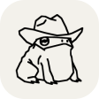
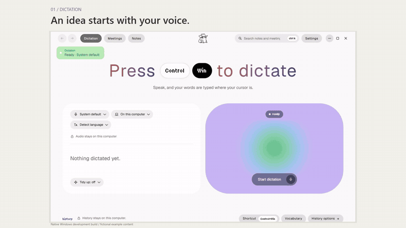
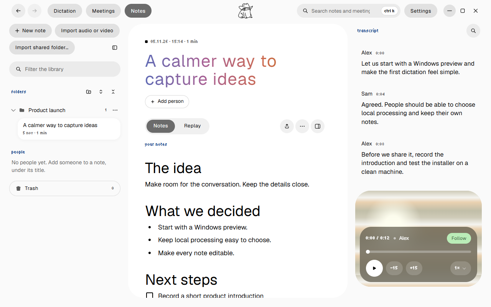
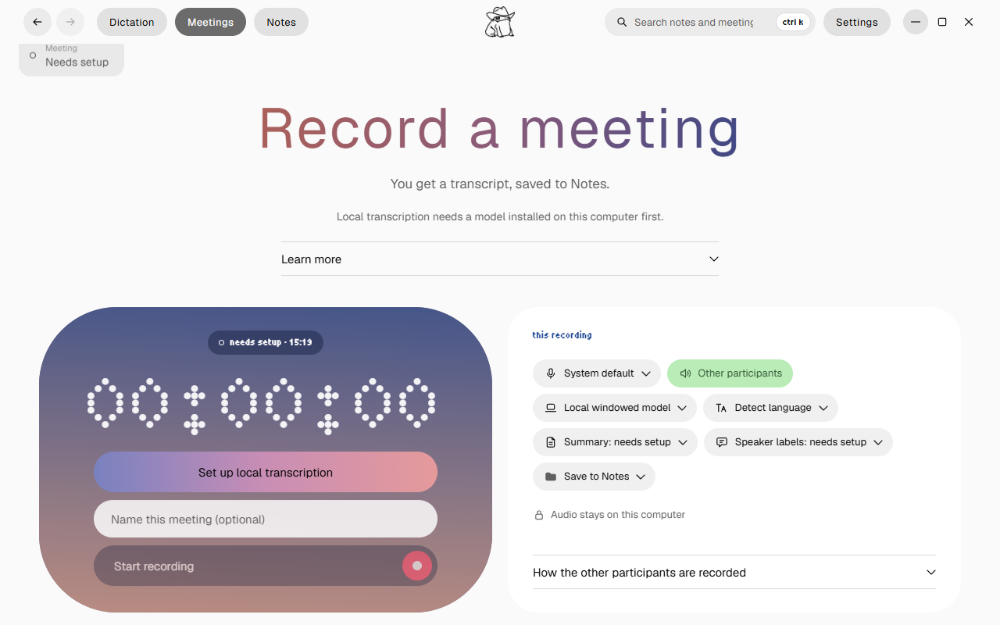
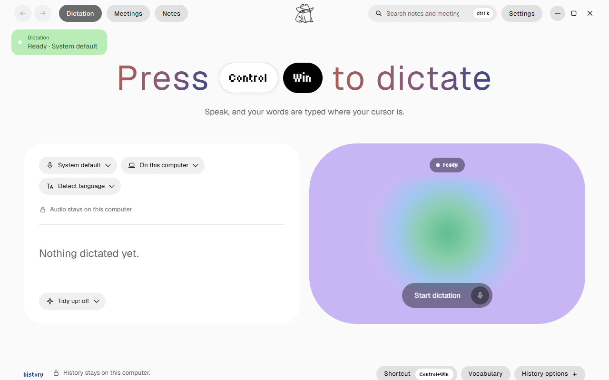

# KnegisWhisper

### Your voice. Your notes. Your machine.

Dictate into your apps, transcribe meetings, and turn recordings into searchable notes.
Run speech models locally or connect your own provider.

[**Get started**](https://github.com/Knegis/KnegisWhisper/releases/tag/v0.1.1) · [Documentation](docs/README.md) · [Contribute](CONTRIBUTING.md) · [Report a bug](https://github.com/Knegis/KnegisWhisper/issues/new/choose)

*Native Windows development build, with fictional example content.
[Intro video and production notes](docs/INTRO_VIDEO.md).*

## Speak. Capture. Keep.

- **Dictate into your apps.** Use a configurable shortcut to turn speech into text where your cursor is.
- **Capture meetings.** Keep a recording, follow its transcript and revisit what was said.
- **Make notes your own.** Edit Markdown, organize folders, search transcripts and export what you need.
- **Choose your processing.** Use local Whisper/Parakeet models or your own cloud-provider credentials.

## Get started

**Early development.** The first Windows release, [v0.1.1](https://github.com/Knegis/KnegisWhisper/releases/tag/v0.1.1),
is unsigned. It has not yet been through the installation checks on a clean machine.
You can also [run from source](docs/DEVELOPMENT.md#development).

For your first dictation:

1. Open **Settings > Transcription** and install a local Whisper runtime and model.
2. Choose your microphone and language on **Dictation**.
3. Set your shortcut in **Settings > Shortcuts**, focus another app and speak.

[Follow the first-use guide](docs/GETTING_STARTED.md)

| Platform | Availability |
| --- | --- |
| Windows x64 | Primary development platform; unsigned [installer](https://github.com/Knegis/KnegisWhisper/releases/tag/v0.1.1) |
| macOS | Source builds; capability-specific limitations |
| Linux | Source builds; capability-specific limitations |

See [platform support](docs/PLATFORM_SUPPORT.md) and [known limitations](docs/KNOWN_LIMITATIONS.md).
The installer targets Windows 11 x64 and is unsigned. Models are downloaded separately.

## From a conversation to a useful note

Record a meeting or import a local audio/video file. Review its transcript, write your
own notes and replay the recording. Search brings you back to the relevant conversation;
exports let you take the result elsewhere.

Optional cleanup and meeting summaries have their own model choices. Keep your
writing editable and choose which processing you want to enable.

## Local when you choose it

No KnegisWhisper account, subscription, telemetry or hosted backend.
Local transcription works offline after its runtime and model are installed.

Cloud transcription, cleanup and summaries send the relevant audio or text directly
to your configured provider. Provider charges may apply. Model downloads and opt-in
integrations also use the network. [See the network purposes](docs/NETWORK_BOUNDARY.md)

## Built to work with your tools

An opt-in local API, CLI and MCP server let other tools work with the running app's
notes, recordings and transcription jobs.
[CLI and MCP setup](docs/CLI_MCP_SETUP.md)

## Help shape KnegisWhisper

Reproducible bug reports, focused fixes, documentation and product feedback are welcome.
Discuss substantial features and design changes before starting implementation.

[Contributing guide](CONTRIBUTING.md) · [Development setup](docs/DEVELOPMENT.md) · [Changelog](CHANGELOG.md) · [Security](SECURITY.md)

## Acknowledgments and license

KnegisWhisper is built on open-source work. Thanks in particular to:

- [Tauri](https://tauri.app) for the desktop app, with [React](https://react.dev) and
  [Vite](https://vite.dev) for its interface.
- [Milkdown](https://milkdown.dev) for the note editor.
- [whisper.cpp](https://github.com/ggml-org/whisper.cpp) for local Whisper transcription,
  and [llama.cpp](https://github.com/ggml-org/llama.cpp) for local text models.
- [sherpa-onnx](https://github.com/k2-fsa/sherpa-onnx) and [ONNX Runtime](https://onnxruntime.ai)
  for Parakeet transcription and speaker labels.
- [FFmpeg](https://ffmpeg.org) for audio and video import.
- [SQLite](https://sqlite.org) through [SQLx](https://github.com/launchbadge/sqlx) for
  local storage, and [cpal](https://github.com/RustAudio/cpal) for audio capture.
- [OpenWhispr](https://github.com/OpenWhispr/openwhispr) (MIT), which parts of
  KnegisWhisper are ported from.

[Silero VAD](https://github.com/snakers4/silero-vad) ships with the app to find speech
in long recordings. The models you download in Settings come from their authors:
OpenAI Whisper, KBLab's KB-Whisper, NVIDIA Parakeet and Nemotron, pyannote and
3D-Speaker for speaker labels, and the local text models listed there. Each keeps its
own license. The interface uses the Geist, Tiny5 and Doto fonts (SIL OFL 1.1).

KnegisWhisper is not affiliated with any of these projects. Licensed under [MIT](LICENSE).
See [NOTICE](NOTICE) for attribution and licenses.
