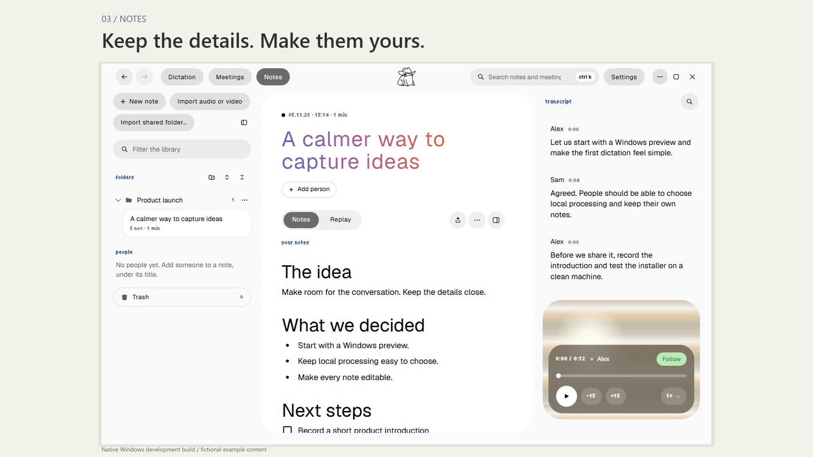

# Product introduction

The 40-second intro uses the real native Windows development app, a disposable
profile, fictional notes and a locally generated Windows text-to-speech recording.
It is silent, captioned, 1920?1080 at 30 fps. The short README loop is an excerpt.



The full MP4 is a local review artifact at
`target/product-media/knegiswhisper-intro.mp4`. Attach it to the draft release as
`knegiswhisper-intro.mp4`; after publication, link the README preview directly to
that public asset. Keep the full MP4 and capture frames out of Git history.

## What this cut shows

- 0?4 seconds: identity and product promise.
- 4?14 seconds: the real Dictation screen with a local route selected.
- 14?22 seconds: the real Meetings screen.
- 22?30 seconds: a fictional note and transcript, followed by an edit through the native editor.
- 30?34 seconds: playback of the synthetic example recording.
- 34?40 seconds: product name, provider choice and repository address.

This is a development UI introduction. The example transcript was authored for
the demonstration. This cut does not demonstrate microphone recognition, dictate
text into another app, or prove installed-release behavior. Replace those scenes
with verified release-candidate recordings before presenting it as an end-to-end
release demo. Real-time speed or model accuracy is not claimed.

## Reproduce the captures

Requirements: Node 22+, Python 3.11+, ffmpeg/ffprobe, Windows with Segoe UI, and a
native debug build. Do not use a personal profile.

1. Set `KW_AUTOMATION_PROFILE` to a new absolute directory and
   `WEBVIEW2_USER_DATA_FOLDER` to a separate directory inside `target`.
2. Set `WEBVIEW2_ADDITIONAL_BROWSER_ARGUMENTS=--remote-debugging-port=9471` before
   launching that debug app. Keep the endpoint local and close the process afterward.
3. Use the application or its native IPC to create a single fictional note named
   **A calmer way to capture ideas**, with the sentence **Fictional example for the
   product demonstration.** in its Markdown, and a short sample transcript.
   Use the example script in `tools/product-media/seed.py` only against the new profile.
4. Select the local dictation and meeting routes; retain a generated sample recording
   with the note for replay. No credentials are needed.
5. From the repository root, run:

```powershell
node tools/product-media/capture.mjs 9471 target/product-media
python tools/product-media/render.py
ffprobe -v error -show_entries format=duration,size -show_entries stream=width,height,r_frame_rate -of json target/product-media/knegiswhisper-intro.mp4
```

The capture script refuses a non-native page or a profile without the expected
fictional note. It captures the actual app renderer and uses native editor input;
it does not replace UI elements with mock content. `capture.json` records source
and limitations. Rendering creates the MP4, GIF and poster; fonts remain local.

Review the opening, each scene transition, visible edit, advancing playback and
closing. Check all captions at narrow README width. The MP4 budget is 20 MB and
the GIF budget is 5 MB.

For a release refresh, capture the reviewed candidate version and change the closing
availability caption only when that release is actually available. Keep the frog,
cream background, restrained type and readable captions consistent.
